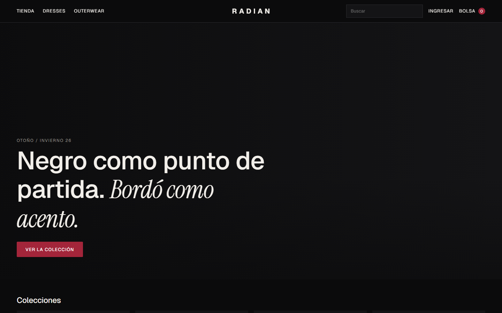
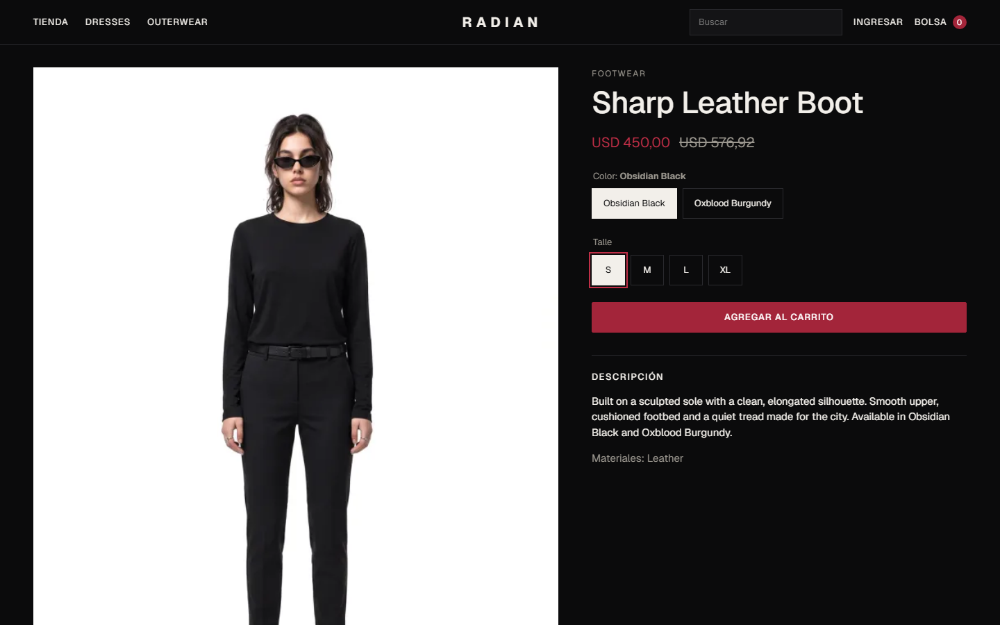
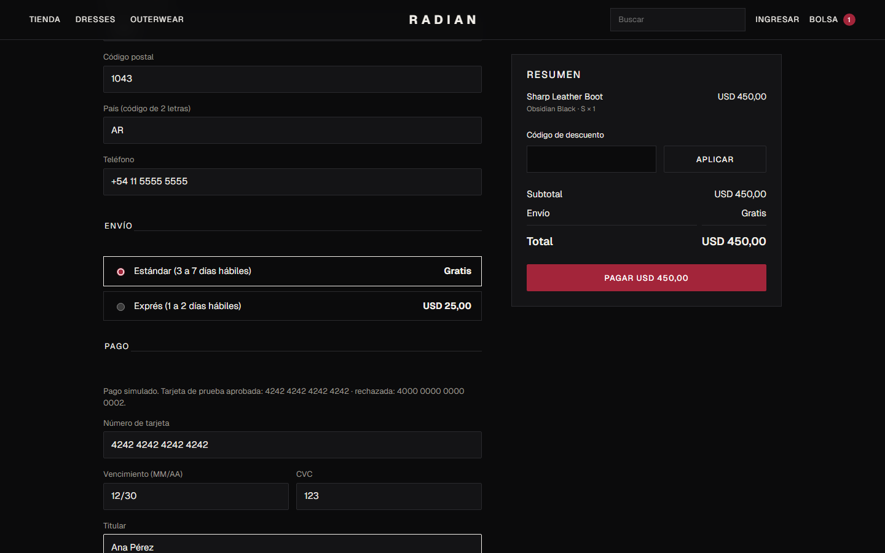
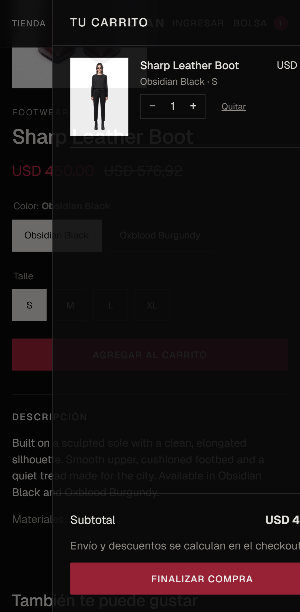
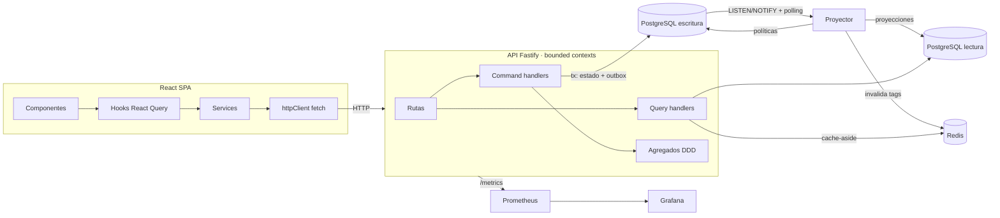
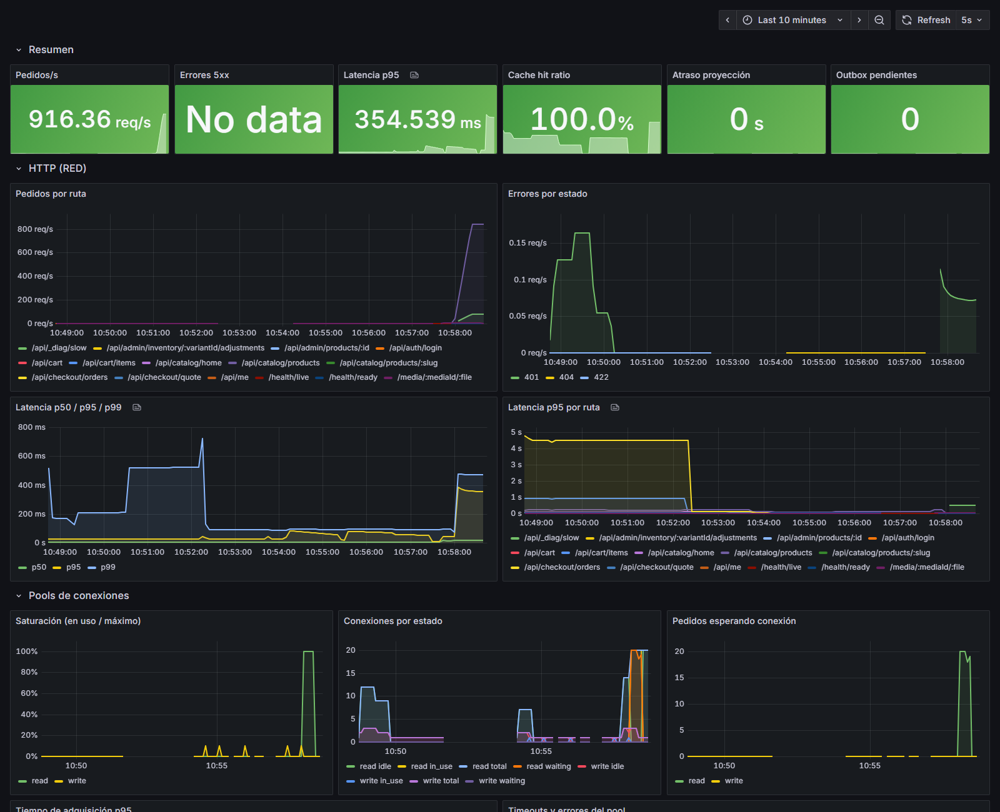

# Radian Store

Tienda de moda full-stack construida como proyecto de portafolio con **Spec-Driven Development**
(GitHub Spec Kit), **TDD**, **DDD + CQRS** con bases separadas de escritura y lectura, caché
invalidada por eventos y observabilidad de punta a punta.



| Capa | Tecnología |
|------|------------|
| Backend | Node.js 24, TypeScript 6 (strict), Fastify 5, Zod 4 |
| Persistencia | PostgreSQL 17 ×2 (escritura / lectura), Redis 8 (caché), almacenamiento de imágenes propio |
| Frontend | React 19, Vite, TanStack Query 5, React Router, `fetch` + capa de servicios |
| Observabilidad | Prometheus, Grafana (dashboard como código), pino (JSON), health checks |
| Calidad | Vitest, Testcontainers, Testing Library, MSW, Playwright, dependency-cruiser, GitHub Actions |

## Qué hace

- **Tienda**: portada, listados con filtros y facetas con conteos, búsqueda tolerante a errores de
  tipeo con sugerencias, ficha de producto con disponibilidad por color × talle.
- **Carrito** persistente en el backend (visitante con cookie firmada o cliente), con merge al
  iniciar sesión y avisos de precio o stock cambiados.
- **Checkout** con envío, códigos de descuento (`WELCOME20`), pago simulado y pedidos.
- **Cuentas** con sesión segura, perfil y dirección predeterminada; historial de pedidos.
- **Administración**: productos, variantes, stock, imágenes (subida y reorden), colecciones y
  gestión de pedidos (envío con seguimiento, cancelación con reintegro).
- **Cuenta demo de solo lectura** (rol `viewer`): recorre todo el panel, pero cualquier
  modificación es rechazada por el servidor (403 `READ_ONLY_ACCOUNT`) y la web explica por qué;
  los datos personales de los clientes se ven enmascarados.
- Catálogo inicial: 21 productos, 168 variantes y 82 imágenes, importados de la tienda Radian
  original con los mismos casos de uso del panel.

| Producto | Checkout | Carrito (mobile) |
|----------|----------|------------------|
|  |  |  |

## Arquitectura



**Bounded contexts**: `identity`, `catalog`, `inventory`, `media`, `cart`, `ordering`. Cada uno
tiene capas `domain → application → infrastructure`. `npm run arch` (dependency-cruiser) falla si
el dominio importa infraestructura, si un contexto importa el dominio de otro o si una consulta
usa repositorios de escritura.

### Decisiones clave

| Problema | Solución | Evidencia |
|----------|----------|-----------|
| Sincronizar escritura → lectura sin 2PC | Outbox transaccional + proyector con `LISTEN/NOTIFY`, checkpoint idempotente por consumidor | Proyección < 1 s (test de integración) |
| Respuestas consistentes pese a la consistencia eventual | Cada comando devuelve el estado resultante (read-your-writes) y React Query lo usa directo | — |
| Sobreventa con compradores concurrentes | `UPDATE … WHERE on_hand - reserved >= q` por variante, en orden fijo (sin deadlocks) | `npm run verify:oversell`: 50 compradores → **1 pagado, 49 sin stock** |
| No retener conexiones durante el cobro | Saga corta: reserva + pedido pendiente → cobro fuera de la transacción → pagado o liberado; job de vencimiento | Tests de rechazo y timeout |
| Doble clic / reintentos | `Idempotency-Key` con hash del request y respuesta guardada | Test: 2 requests simultáneos → 1 pedido |
| Consultas caras | Redis cache-aside con invalidación O(1) por versión de tag y circuit breaker | p97,5 de **21 ms**, ~1500 req/s, 99,8 % de aciertos |
| Agotamiento de conexiones | Pools instrumentados (adquisición, timeouts → 503) + monitor de saturación con avisos | Dashboard y logs `pool.saturated` / `pool.recovered` |
| Imágenes | Validación por firma real, sin EXIF, WebP en 5 anchos, `srcset`, caché inmutable, dedupe por sha256 y autorreparación | — |

## Observabilidad

`/health/live`, `/health/ready` (bases, caché y atraso del proyector, siempre < 2 s), `/metrics` y
un dashboard de Grafana provisionado como código ([`infra/grafana/dashboard.mjs`](infra/grafana/dashboard.mjs)).



## Cómo levantarlo

Requisitos: Docker y Node.js 24.

```bash
npm install
cp apps/api/.env.example apps/api/.env
npm run dev:infra      # PostgreSQL ×2, Redis, Prometheus, Grafana
npm run db:migrate
npm run seed           # catálogo de Radian (idempotente)
npm run dev            # API http://localhost:3000 · Web http://localhost:5173
```

Todo en contenedores:

```bash
docker compose -f infra/docker-compose.yml --profile app up --build -d
docker compose -f infra/docker-compose.yml exec api node dist/src/scripts/seed-catalog.js
# Web http://localhost:8080
```

| Servicio | URL |
|----------|-----|
| Tienda | http://localhost:5173 (dev) · http://localhost:8080 (contenedores) |
| Admin | `/admin` con `admin@radian.store` / `admin-password-123` |
| Demo de solo lectura | `demo@radian.store` / `demo-password-123` (botón "Usar cuenta demo" en el login) |
| Estado | `/estado` · http://localhost:3000/health/ready |
| Grafana | http://localhost:3001 (admin / admin) |
| Prometheus | http://localhost:9090 |

Tarjetas de prueba: `4242 4242 4242 4242` (aprobada), `4000 0000 0000 0002` (rechazada),
`4000 0000 0000 9995` (fondos insuficientes), `4000 0000 0000 0119` (timeout del proveedor).

## Calidad

```bash
npm test                 # unitarios + contrato (API) y componentes (web)
npm run test:integration # contra PostgreSQL y Redis reales (Testcontainers)
npm run test:e2e         # compra completa en Chromium, desktop y mobile (stack levantado)
npm run lint && npm run typecheck && npm run arch
```

- API: 114 tests unitarios y de contrato + 67 de integración contra PostgreSQL y Redis reales.
- Web: 59 tests de componentes con Testing Library + MSW.
- E2E: compra completa como invitado en desktop y mobile, también contra la versión dockerizada.

## Spec-Driven Development

Todo el código nace de specs y tareas ([Spec Kit](https://github.com/github/spec-kit)):

- Constitución: [`.specify/memory/constitution.md`](.specify/memory/constitution.md) (TDD
  obligatorio, DDD, CQRS, pools, caché, observabilidad, contratos tipados).
- Por feature: `spec.md` → `plan.md` (+ research, data-model, contracts, quickstart) → `tasks.md`.

| Feature | Qué entrega |
|---------|-------------|
| [001](specs/001-platform-foundation/spec.md) | Monorepo, pools monitoreados, outbox/proyector, caché, health, métricas, Grafana |
| [002](specs/002-customer-accounts/spec.md) | Registro, login, perfil, rol administrador |
| [003](specs/003-catalog-management/spec.md) | Administración de productos, variantes, stock, imágenes y colecciones |
| [004](specs/004-catalog-browsing/spec.md) | Tienda: listados con facetas, búsqueda, ficha de producto, caché |
| [005](specs/005-shopping-cart/spec.md) | Carrito persistente con merge al iniciar sesión |
| [006](specs/006-checkout-orders/spec.md) | Checkout idempotente, reservas sin sobreventa, pedidos y administración |
| [007](specs/007-admin-viewer-role/spec.md) | Rol de solo lectura para el panel (demo segura) |
