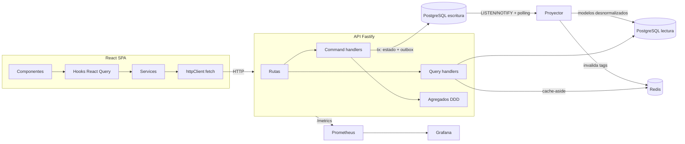

# Radian Store

Tienda de moda full-stack construida como proyecto de portafolio con **Spec-Driven Development**
(GitHub Spec Kit), **TDD**, **DDD + CQRS** y observabilidad de punta a punta.

| Capa | Tecnología |
|------|------------|
| Backend | Node.js 24, TypeScript 6 (strict), Fastify 5, Zod 4 |
| Persistencia | PostgreSQL 17 ×2 (escritura / lectura), Redis 8 (caché) |
| Frontend | React 19, Vite, TanStack Query 5, React Router, `fetch` + capa de servicios |
| Observabilidad | Prometheus, Grafana (dashboards como código), pino, health checks |
| Calidad | Vitest, Testcontainers, Testing Library, MSW, Playwright, dependency-cruiser, GitHub Actions |

## Arquitectura



- **CQRS**: los comandos escriben en la base de escritura junto con sus eventos (outbox
  transaccional). Un proyector idempotente los aplica a la base de lectura en < 1 s y luego
  invalida la caché por tags. Las consultas leen solo de la base de lectura.
- **DDD**: bounded contexts (`identity`, `catalog`, `inventory`, `media`, `cart`, `ordering`)
  con capas `domain → application → infrastructure`. `npm run arch` verifica la regla de
  dependencias.
- **Pools**: toda conexión pasa por un pool instrumentado (tiempo de adquisición, timeouts,
  saturación) con un monitor que avisa cuando se satura y cuando se recupera.
- **Caché**: Redis cache-aside con invalidación O(1) por versión de tag y circuit breaker. Si
  Redis cae, la tienda sigue funcionando.

## Cómo levantarlo

Requisitos: Docker y Node.js 24.

```bash
npm install
cp apps/api/.env.example apps/api/.env
npm run dev:infra      # PostgreSQL ×2, Redis, Prometheus, Grafana
npm run db:migrate
npm run dev            # API http://localhost:3000 · Web http://localhost:5173
```

O todo en contenedores: `docker compose -f infra/docker-compose.yml --profile app up --build`
(web en http://localhost:8080).

| Servicio | URL |
|----------|-----|
| Web | http://localhost:5173 |
| API health | http://localhost:3000/health/ready |
| Métricas | http://localhost:3000/metrics |
| Grafana | http://localhost:3001 (admin / admin) |
| Prometheus | http://localhost:9090 |

## Calidad

```bash
npm test                 # unitarios + contrato (API) y componentes (web)
npm run test:integration # contra PostgreSQL y Redis reales (Testcontainers)
npm run lint && npm run typecheck && npm run arch
```

## Spec-Driven Development

- Constitución del proyecto: [`.specify/memory/constitution.md`](.specify/memory/constitution.md)
- Specs por feature (spec → plan → tasks): [`specs/`](specs/)

| Feature | Qué entrega |
|---------|-------------|
| [001](specs/001-platform-foundation/spec.md) | Monorepo, pools monitoreados, outbox/proyector, caché, health, métricas, Grafana |
| [002](specs/002-customer-accounts/spec.md) | Registro, login, perfil, rol administrador |
| [003](specs/003-catalog-management/spec.md) | Administración de productos, variantes, stock, imágenes y colecciones |
| [004](specs/004-catalog-browsing/spec.md) | Tienda: listados con filtros y facetas, búsqueda, ficha de producto, caché |
| [005](specs/005-shopping-cart/spec.md) | Carrito persistente con merge al iniciar sesión |
| [006](specs/006-checkout-orders/spec.md) | Checkout idempotente, reservas de stock sin sobreventa, pedidos |
